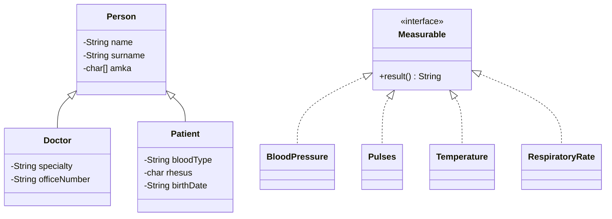

# Clinic Management System (Java)

**A console-based clinic information system in Java: manage doctors and patients, record vital signs, and get an automatic, age-aware interpretation of each measurement, with data persisted to CSV.**


## Overview

A small but complete example of object-oriented design applied to a healthcare domain. The program keeps doctors, patients and measurements in memory, validates every input, and saves everything back to CSV files when you exit.

> The user interface and the stored interpretation labels are in **Greek**. *AMKA* is the Greek 11-digit social security number, used here as the unique person identifier.

## Features

- **Doctors**: list, add, and edit (name, surname, AMKA, specialty, office number).
- **Patients**: list and register (name, surname, AMKA, blood group + Rhesus factor, date of birth).
- **Vital signs**: record a measurement for a registered patient and review all measurements for an AMKA. Every measurement is timestamped and stored with its interpretation.
- **Input validation** on every field: AMKA must be 11 digits; names are letters only; blood group must be a valid ABO/Rh combination (Latin or Greek letters accepted); the date of birth must be a valid `dd/MM/yyyy` date that is not in the future; office numbers are at most 3 digits; measurements must be well-formed numbers, with plausibility bounds on blood pressure and temperature.
- **CSV persistence**: data is loaded from `doctors.csv`, `patients.csv` and `measurements.csv` at start-up and written back on a proper exit.

### Measurement interpretation

| Measurement | Input | Interpretation |
|---|---|---|
| Blood pressure | `systolic/diastolic` (mmHg) | Flags elevated pressure (thresholds at 120/80 and 140/90 mmHg) |
| Pulse | beats per minute | Reduced / normal / increased, using reference ranges that depend on the patient's age (infancy through adulthood) |
| Temperature | °C | Hypothermia (< 36.5), normal, fever (> 37.5) |
| Respiratory rate | breaths per minute | Bradypnoea / normal / tachypnoea, using age-banded ranges (neonate through over-80s) |

Age is computed from the patient's stored date of birth. The reference ranges used are noted in the source comments.

## Design



- **Inheritance**: `Doctor` and `Patient` extend `Person`.
- **Polymorphism**: each measurement type implements the `Measurable` interface and supplies its own `result()` interpretation logic.
- **Separation of concerns**: `Clinic0_1` handles the menu, input validation and file I/O; the domain classes own their data and rules.

## Repository structure

```
.
├── Clinic0_1.java        # entry point: menu, input validation, CSV load/save
├── Person.java  Doctor.java  Patient.java
├── Measurable.java       # interface
├── BloodPressure.java  Pulses.java  Temperature.java  RespiratoryRate.java
├── PersonTester.java     # small driver exercising the Person classes
└── doctors.csv  patients.csv  measurements.csv    # sample data
```

## Getting started

Requires a JDK (8 or later). From the repository folder:

```bash
javac -encoding UTF-8 *.java
java Clinic0_1
```

Run it from the folder that contains the CSV files. The menu is numbered; choose **8** to save and exit. Data is written **only on exit through the menu**, so quitting any other way discards the session's changes. If a CSV is missing, the program reports it at start-up and creates the file on exit. Use a UTF-8 terminal so the Greek text displays correctly.

The bundled CSVs contain a few placeholder records. `PersonTester` is a standalone test driver, and running it overwrites `doctors.csv` and `patients.csv` with its own sample content.
